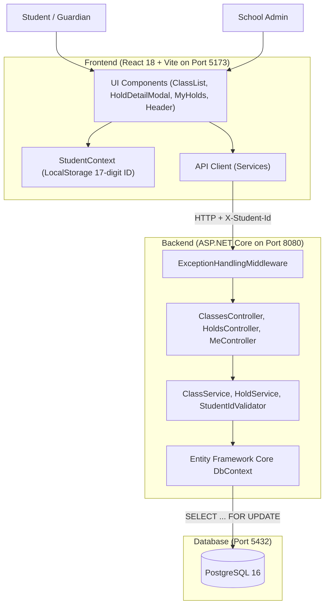
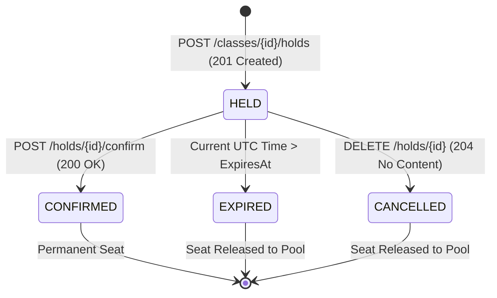

# School Admission System (বিদ্যালয় ভর্তি কার্যক্রম)

An online school admission system designed for high-concurrency, **First-Come, First-Served (FCFS)** enrollment without a lottery mechanism.

This project was developed as a take-home hiring assignment for **OnnoRokom Projukti Limited — Assistant Software Engineer Recruitment**.

The system focuses on fair seat allocation, temporary seat reservations, concurrency handling, and preventing overbooking when multiple students attempt to reserve the final available seats simultaneously.

---

## 1. Quick Start — Docker (Docker দিয়ে App চালানোর ধাপ)

The easiest way to run the complete application is with Docker Compose. **Host মেশিনে Node.js, .NET বা PostgreSQL ইনস্টল থাকার প্রয়োজন নেই।**

### Prerequisites

- Docker Desktop
- Docker Compose

### Run the application

From the repository root directory:

```bash
docker compose up --build
```

After the containers build and start successfully, access the application at:

| Service | URL | বিবরণ |
|---|---|---|
| **Frontend UI (ব্রাউজারে খুলুন)** | **http://localhost:5173** | মূল ইউজার ইন্টারফেস (শিক্ষার্থী ও অ্যাডমিন) |
| **Backend Web API** | **http://localhost:8080** | ASP.NET Core REST API |
| **PostgreSQL Database** | **localhost:5432** | PostgreSQL ডাটাবেজ পোর্ট |

### To stop the application

To stop containers while preserving database data:

```bash
docker compose down
```

To stop containers and reset the database volume:

```bash
docker compose down -v
```

> **Warning:** The `-v` option removes persisted database data. Use it only when you want to reset the database.

### Useful Docker commands

View running containers:

```bash
docker compose ps
```

View application logs:

```bash
docker compose logs -f
```

View backend logs only:

```bash
docker compose logs -f backend
```

View frontend logs only:

```bash
docker compose logs -f frontend
```

---

## 2. Project Overview

A private school conducts its annual online admission process. Students can view available classes and reserve seats based on a First-Come, First-Served policy.

There is no lottery system. Seat allocation depends on successful reservation requests and the availability of seats at the time the server processes each request.

The main challenge is handling concurrent requests safely.

For example:

- A class has only 5 available seats.
- 50 students send reservation requests at approximately the same time.
- The system must not allocate more than 5 seats.
- Requests that cannot obtain a seat should receive an appropriate response (`409 Conflict`).

The application uses PostgreSQL transactions and row-level locking to coordinate reservation requests and protect seat availability.

### Core invariant

At any point, the following condition must remain true:

```text
Active Holds + Confirmed Admissions <= Total Seats
```

This invariant is the foundation of the admission and reservation logic.

---

## 3. Key Features

### Student Features

- View available classes and admission information.
- Check total, reserved, confirmed, and available seats.
- Temporarily reserve an available seat (`POST /classes/{classId}/holds`).
- View reservation details and live expiration countdown timer (`GET /holds/{holdId}`).
- Confirm admission through a simulated payment process ("ভর্তি ফি দিন", `POST /holds/{holdId}/confirm`).
- Cancel an active reservation voluntarily ("বাতিল", `DELETE /holds/{holdId}`).
- View personal reservation history ("আমার আবেদনসমূহ", `GET /me/holds`).

### Admin Features

- Create new admission classes and shifts with seat quotas (`POST /classes`).
- Define class name, shift, and the total number of available seats.
- Prevent duplicate class names according to the application's uniqueness rule.

### Reservation Management

- First-Come, First-Served (FCFS) seat allocation.
- Temporary seat reservation with a configurable expiration time (`HOLD_DURATION_SECONDS`, default: 600s).
- Automatic exclusion of expired holds from available-seat calculations (zero-latency seat reclamation).
- Reservation confirmation (idempotent; duplicate confirmations do not increment seats).
- Voluntary reservation cancellation immediately returning the seat to the available pool.
- Protection against overbooking through database transactions and row-level locking.

### Concurrency Handling

- PostgreSQL transaction-based reservation processing (`IsolationLevel.ReadCommitted`).
- `SELECT * FROM classes WHERE "Id" = @classId FOR UPDATE` to serialize competing requests for the same class.
- Availability calculation inside the lock boundary.
- HTTP `409 Conflict` when no seat is available.
- Database-level protection against exceeding the seat limit.

---

## 4. Technology Stack

| Category | Technology |
|---|---|
| Backend | C#, .NET 10, ASP.NET Core Web API (Port 8080) |
| ORM | Entity Framework Core 10 |
| Database | PostgreSQL 16 (Port 5432) |
| Frontend | React 18.3, TypeScript, Modern CSS (Port 5173) |
| Build Tool | Vite 5 |
| Testing | xUnit, EF Core InMemory Provider, Asynchronous Concurrency Tasks |
| Containerization | Docker, Docker Compose |

---

## 5. System Architecture

The application follows a clean client-server architecture:



### Request Lifecycle

1. A student sends a reservation request from the frontend.
2. The backend validates the 17-digit student identifier (`X-Student-Id`).
3. The reservation service starts a database transaction.
4. The system locks the relevant class row with `SELECT ... FOR UPDATE`.
5. It calculates the number of active holds and confirmed admissions.
6. If a seat is available, the system creates a temporary hold.
7. Otherwise, the transaction rolls back and the request is rejected with `409 Conflict`.
8. The transaction commits and returns `201 Created`.
9. The frontend displays the reservation modal with a live countdown timer.

---

## 6. Database Design and Concurrency Strategy

### 6.1 Why Concurrency Handling Is Important

Consider a class with only one available seat. Two students submit reservation requests at almost the same millisecond. Without proper concurrency control, both requests might read the same available-seat count before either request inserts a reservation, causing a race condition and overbooking.

### 6.2 PostgreSQL Row-Level Locking

The system uses PostgreSQL's `SELECT ... FOR UPDATE` to lock the relevant class row during the reservation transaction:

```sql
BEGIN TRANSACTION ISOLATION LEVEL READ COMMITTED;

-- 1. Acquire exclusive tuple write lock on the target class row
SELECT * FROM classes WHERE "Id" = @classId FOR UPDATE;

-- 2. Count active unexpired holds and confirmed admissions
SELECT COUNT(*) FROM holds 
WHERE "ClassId" = @classId 
  AND ("Status" = 'CONFIRMED' OR ("Status" = 'HELD' AND "ExpiresAt" > CURRENT_TIMESTAMP));

-- 3. If available <= 0: ROLLBACK and return 409 Conflict
-- 4. If available > 0: INSERT hold, COMMIT, and return 201 Created
COMMIT;
```

In `HoldService.cs`, this is executed via EF Core:

```csharp
schoolClass = await _dbContext.Classes
    .FromSqlRaw("SELECT * FROM classes WHERE \"Id\" = {0} FOR UPDATE", classId)
    .FirstOrDefaultAsync();
```

### 6.3 Reservation Processing Flow

```text
Reservation Request
        |
        v
Start ReadCommitted Transaction
        |
        v
Lock Class Row (SELECT ... FOR UPDATE)
        |
        v
Calculate Available Seats
        |
        v
Is a Seat Available?
       / \
     Yes  No
      |    |
      v    v
Create   Rollback & Return
Hold     409 Conflict
      |
      v
Commit Transaction
      |
      v
Return 201 Created
```

### 6.4 Why `SELECT ... FOR UPDATE`?

When multiple requests attempt to reserve seats in the same class, the row lock ensures that competing transactions cannot simultaneously pass the availability check based on the same unlocked class row.

The next transaction must wait until the current transaction releases the lock. It then evaluates availability using the committed database state.

This prevents multiple requests from allocating the same remaining capacity, even when multiple backend instances or containers run in parallel.

### 6.5 Available Seat Calculation

The system considers:

```text
Available Seats = Total Seats - Active Holds - Confirmed Admissions
```

A hold is considered active only while its expiration time is in the future:

```text
Active Hold:  Status == 'HELD' && ExpiresAt > Current UTC Time
Expired Hold: Status == 'HELD' && ExpiresAt <= Current UTC Time
```

Expired holds are excluded dynamically from availability calculations. This allows their seats to become available for new reservation requests with **zero latency** without requiring a separate background cleanup job to run first.

### 6.6 Temporary Reservation Lifecycle



---

## 7. Repository Structure

The repository strictly follows the mandatory layout required by the assignment:

```text
School Admission System/
├── frontend/
│   ├── public/
│   ├── src/
│   │   ├── components/         # Header, ClassList, HoldDetailModal, MyHolds, ClassCreateModal
│   │   ├── context/            # StudentContext (persists 17-digit ID in localStorage)
│   │   ├── services/           # Typed API client with X-Student-Id injection
│   │   ├── types/              # DTO TypeScript interfaces
│   │   ├── App.tsx             # Main view router
│   │   ├── index.css           # Responsive styles & status badges
│   │   └── main.tsx
│   ├── .env.example
│   ├── Dockerfile              # Node 20 Alpine Vite development server
│   ├── package.json
│   ├── tsconfig.json
│   └── vite.config.ts
│
├── backend/
│   ├── src/
│   │   └── SchoolAdmissionSystem.Api/
│   │       ├── Common/         # StudentIdValidator (regex ^[0-9]{17}$)
│   │       ├── Controllers/    # ClassesController, HoldsController, MeController
│   │       ├── Data/           # ApplicationDbContext with PostgreSQL composite indexes
│   │       ├── DTOs/           # Request & Response public DTO contracts
│   │       ├── Exceptions/     # DomainExceptions (mapped to 400, 403, 404, 409)
│   │       ├── Middleware/     # ExceptionHandlingMiddleware (dual error contract)
│   │       ├── Models/         # SchoolClass, SeatHold, HoldStatus
│   │       ├── Services/       # ClassService, HoldService (concurrency row lock)
│   │       ├── Program.cs      # Native .NET OpenApi, CORS, DI, Kestrel port 8080
│   │       ├── appsettings.json
│   │       └── SchoolAdmissionSystem.Api.csproj
│   │
│   ├── tests/
│   │   └── SchoolAdmissionSystem.Tests/
│   │       ├── ClassManagementTests.cs
│   │       ├── HoldLifecycleTests.cs
│   │       ├── ExpirationAndCancellationTests.cs
│   │       ├── StudentRuleTests.cs
│   │       ├── ConcurrencyTests.cs    # 50-task parallel burst & race for final seat
│   │       ├── TestDbContextFactory.cs
│   │       └── SchoolAdmissionSystem.Tests.csproj
│   │
│   ├── Dockerfile              # Multi-stage SDK build to ASP.NET Core runtime
│   └── SchoolAdmissionSystem.sln
│
├── docker-compose.yml          # Root-level multi-container orchestration
├── README.md                   # Complete system documentation
├── ASSUMPTIONS.md              # 14 domain assumptions + multi-instance concurrency proof
├── AI_USAGE.md                 # 10-point transparent AI usage disclosure
├── .env.example                # Configurable environment variable template
└── .gitignore                  # Clean exclusions (bin/, obj/, node_modules/, dist/, .env)
```

---

## 8. API Documentation

Base URL:

```text
http://localhost:8080
```

All successful JSON responses use **camelCase** property names.

### API Endpoints

| Method | Endpoint | Required Header | Request Body | Description |
|---|---|---|---|---|
| `GET` | `/classes` | None | None | Retrieve all classes with live seat counts |
| `GET` | `/classes/{classId}` | None | None | Retrieve single class details and seat counts |
| `POST` | `/classes` | None | `{"name": "...", "totalSeats": 120}` | Create a new class or shift (Admin) |
| `POST` | `/classes/{classId}/holds` | `X-Student-Id` | None | Create a temporary seat hold for student |
| `GET` | `/holds/{holdId}` | None | None | Retrieve hold details and effective status |
| `POST` | `/holds/{holdId}/confirm` | `X-Student-Id` | None | Confirm a held seat (simulated payment) |
| `DELETE` | `/holds/{holdId}` | `X-Student-Id` | None | Cancel a hold and release seat to pool |
| `GET` | `/me/holds` | `X-Student-Id` | None | List the current student's hold history |

### Important HTTP Status Codes

| Status Code | Meaning | When Returned |
|---|---|---|
| `200 OK` | Success | Successful reads, idempotent confirmations |
| `201 Created` | Resource Created | Class created, hold reserved |
| `204 No Content` | No Content | Successful hold cancellation |
| `400 Bad Request` | Validation Error | Missing/invalid `X-Student-Id` (must be 17 digits), invalid seats |
| `403 Forbidden` | Forbidden | Student attempts to confirm or cancel another student's hold |
| `404 Not Found` | Not Found | Requested class or hold does not exist |
| `409 Conflict` | Conflict | Class is full, student already has active hold in class, hold expired, class name duplicate |
| `500 Internal Error` | Server Error | Unhandled server error |

### Student Identification

The application uses the following request header to identify a student:

```http
X-Student-Id: 20152691234567890
```

- Must contain exactly 17 numeric digits (`^[0-9]{17}$`).
- If missing or invalid on student endpoints, returns `400 Bad Request`.
- In the React UI, this is entered once in the header and saved in `localStorage`.

---

## 9. Environment Configuration

All settings are configurable via environment variables (see `.env.example` at root):

| Variable | Default | Used by | Description |
|---|---|---|---|
| `POSTGRES_DB` | `school_admission` | PostgreSQL | Database name |
| `POSTGRES_USER` | `postgres` | PostgreSQL | Database username |
| `POSTGRES_PASSWORD` | `postgres` | PostgreSQL | Database password |
| `POSTGRES_PORT` | `5432` | Host / Docker | Host port mapping for PostgreSQL |
| `HOLD_DURATION_SECONDS` | `600` | Backend API | Duration of a seat hold in seconds (10 mins) |
| `ASPNETCORE_URLS` | `http://+:8080` | Backend API | Kestrel listener URL |
| `ConnectionStrings__DefaultConnection` | `Host=localhost;Port=5432;...` | Backend API | PostgreSQL connection string |
| `VITE_API_BASE_URL` | `http://localhost:8080` | Frontend UI | Backend API URL target |

---

## 10. Running Locally Without Docker

### Prerequisites

- .NET 8.0 SDK or .NET 10.0 SDK
- PostgreSQL 16 running locally on port 5432
- Node.js 20+ and npm

### Backend Setup

From repository root:

```bash
cd backend/src/SchoolAdmissionSystem.Api
dotnet run
```

Or run directly from root using:

```bash
dotnet run --project backend/src/SchoolAdmissionSystem.Api
```

The backend initializes the database schema automatically via `EnsureCreatedAsync()` on startup and listens on `http://localhost:8080`.

### Frontend Setup

Open another terminal:

```bash
cd frontend
npm install
npm run dev
```

The frontend starts on `http://localhost:5173` and connects to the backend on `http://localhost:8080`.

---

## 11. Testing Strategy (Test চালানোর নিয়ম)

The backend test suite is located in `backend/tests/SchoolAdmissionSystem.Tests/` and contains **31 automated test executions** (24 xUnit `[Fact]` and `[Theory]` methods).

### Run Backend Tests

From the repository root, run:

```bash
dotnet test backend/tests/SchoolAdmissionSystem.Tests/SchoolAdmissionSystem.Tests.csproj
```

Or run against the solution:

```bash
dotnet test backend/SchoolAdmissionSystem.sln
```

### Key Test Scenarios Covered

| Test Name | Scenario & Verification |
|---|---|
| `CreateHold_UnderHighBurstConcurrency_NeverExceedsTotalSeats` | 50 concurrent requests competing for 5 seats. Exactly 5 succeed, 45 receive `409 Conflict`. Invariant $\text{held} + \text{confirmed} \le \text{totalSeats}$ strictly holds. |
| `CreateHold_SimultaneousRaceForFinalAvailableSeat_AllowsOnlyOneSuccess` | 25 concurrent requests competing for 1 remaining seat. Exactly 1 succeeds, 24 fail with `409 Conflict`. Zero overselling. |
| `ConfirmHold_WhenAlreadyConfirmed_IsIdempotent` | Calling confirm repeatedly on an already confirmed hold returns `200 OK` without incrementing confirmed seats. |
| `ExpiredHold_AutomaticallyReleasesSeat_WithoutManualIntervention` | Expired holds release seats automatically with zero latency without background cron delays. |
| `ConfirmHold_WhenExpired_ThrowsConflictException` | Attempting to confirm an expired hold returns `409 Conflict`. |
| `CancelHold_WhenHeldAndOwner_TransitionsToCancelledAndReleasesSeat` | Cancelling an active hold releases the seat immediately to other students. |
| `CancelHold_WhenAlreadyConfirmed_ThrowsConflictException` | Confirmed admissions cannot be cancelled. |
| `CreateHold_WhenStudentAlreadyHasActiveHoldInSameClass_ThrowsConflictException` | Enforces at most 1 active hold per student per class. |
| `CreateClass_WhenClassWithSameNameAlreadyExists_ThrowsConflictException` | Duplicate class names are blocked. |
| `CreateHold_WithInvalidStudentId_ThrowsValidationException` | Non-17-digit IDs (16 digits, 18 digits, letters, empty) are rejected with `400 Bad Request`. |

### Frontend Build Test

```bash
cd frontend
npm run build
```

Compiles TypeScript and bundles via Vite with zero warnings and zero errors.

---

## 12. Business Rules

1. **First-Come, First-Served (FCFS):** Admission follows strict FCFS ordering without a lottery.
2. **Student Identity:** Student ID is strictly 17 digits passed in `X-Student-Id`.
3. **Single Active Application:** A student cannot have more than one live hold or confirmed admission in the same class.
4. **Re-Application:** If a hold expires or is cancelled, the student may apply again if seats remain.
5. **Idempotent Confirmation:** Multiple confirmation requests on an already confirmed hold return `200 OK`.
6. **No Confirmation After Expiry:** An expired or cancelled hold cannot be confirmed (`409 Conflict`).
7. **Permanent Admission:** A confirmed admission cannot be cancelled (`409 Conflict`).
8. **Ownership Verification:** Only the student who reserved a hold can confirm or cancel it (`403 Forbidden` for other students).
9. **Capacity Invariant:** Total occupied seats must never exceed total seats under any concurrency:
   $$\text{live held seats} + \text{confirmed seats} \le \text{total seats}$$

---

## 13. Example API Requests

### 1. Create a Class (Admin)

```bash
curl -X POST http://localhost:8080/classes \
  -H "Content-Type: application/json" \
  -d "{\"name\":\"Class 6 - Morning Shift\",\"totalSeats\":120}"
```

### 2. List Classes with Live Seat Counts

```bash
curl http://localhost:8080/classes
```

### 3. Create a Hold (Student)

```bash
curl -X POST http://localhost:8080/classes/c_4a91fbc2/holds \
  -H "X-Student-Id: 20152691234567890"
```

### 4. Confirm a Hold (Pay Fee)

```bash
curl -X POST http://localhost:8080/holds/h_7d82e10a/confirm \
  -H "X-Student-Id: 20152691234567890"
```

### 5. Cancel a Hold

```bash
curl -X DELETE http://localhost:8080/holds/h_7d82e10a \
  -H "X-Student-Id: 20152691234567890"
```

### 6. View My Applications

```bash
curl http://localhost:8080/me/holds \
  -H "X-Student-Id: 20152691234567890"
```

---

## 14. Known Limitations

- **Simulated Payment:** As permitted in the assignment, clicking "ভর্তি ফি দিন" confirms the admission without an external payment gateway.
- **Simplified Authentication:** Student identity is passed via `X-Student-Id` per assignment rules; production systems should use JWT tokens and an identity provider.
- **Single Database Node:** PostgreSQL row locking protects concurrency on a single database; high availability across multiple datacenters is outside the scope of this assignment.
- **Client Polling:** Frontend polls every 3.5 seconds to refresh inventory; WebSockets or Server-Sent Events (SSE) would reduce HTTP overhead in large-scale deployments.

---

## 15. Assumptions and AI Usage

- Detailed technical and domain assumptions are documented in **[ASSUMPTIONS.md](./ASSUMPTIONS.md)**.
- Transparent AI tool usage, code reviews, and verification steps are documented in **[AI_USAGE.md](./AI_USAGE.md)**.
