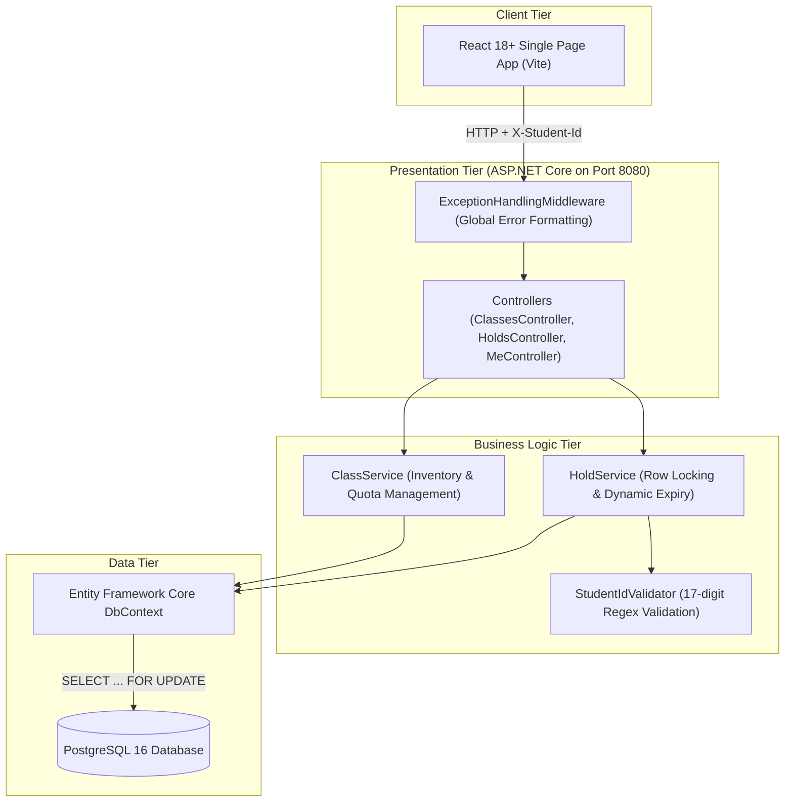
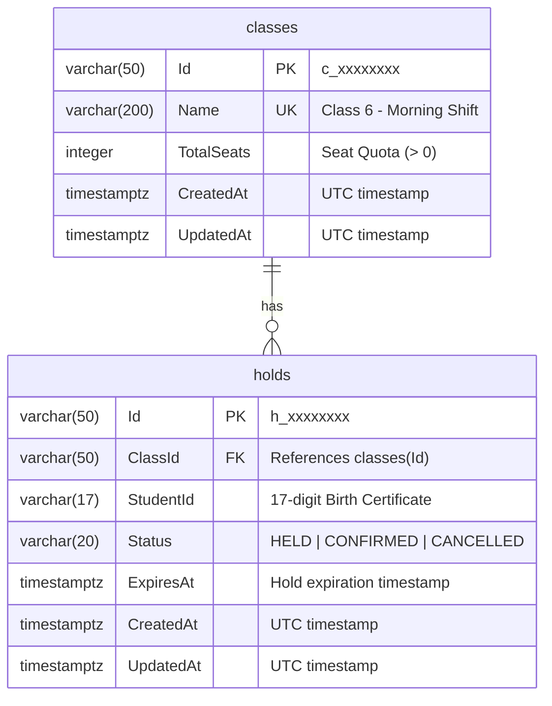
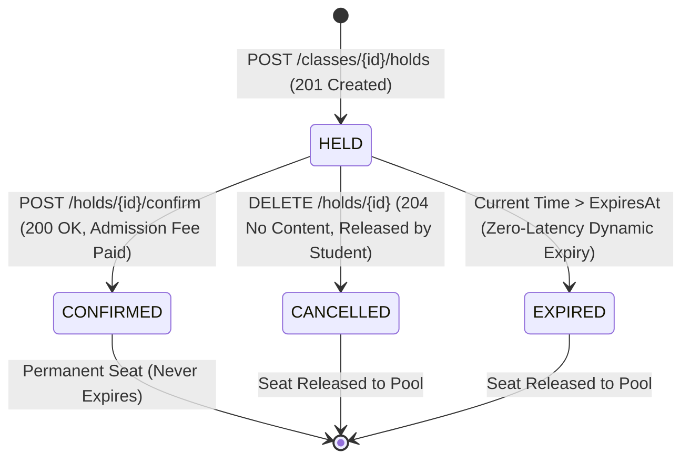

# School Admission System (বিদ্যালয় ভর্তি কার্যক্রম)

An online admission system designed for high-concurrency "first-come, first-served" (FCFS) enrollment with **no lottery**, built as a take-home hiring assignment for **Onnorokom Projukti Limited** (Assistant Software Engineer Recruitment).

---

## 1. Project Overview

In this admission scenario, a private school conducts its annual online enrollment. Each class and shift (e.g., *"Class 6 – Morning Shift"*, *"Class 6 – Day Shift"*) has a strictly limited number of seats (e.g., 120 seats). Admission is granted on a strict **first-come, first-served** basis without a lottery.

The moment enrollment opens, thousands of parents simultaneously apply for limited seats. When a parent applies, a seat is placed on a temporary **hold** in the student's name for a configurable duration (default: 10 minutes / 600 seconds, controlled by `HOLD_DURATION_SECONDS`). If the admission fee is paid (simulated) within this window, the seat becomes permanently **confirmed**. If the window expires without payment or if the parent cancels, the seat automatically returns to the pool of available seats for others with **zero latency**.

The paramount system requirement is:
$$\text{held} + \text{confirmed} \le \text{totalSeats}$$
Under no circumstances may the system oversell seats, even under intense concurrent bursts.

---

## 2. Features

### For Guardians & Students
- **Student Identity via Birth Registration:** No login or registration required; student identity is derived strictly from their 17-digit Birth Registration Number (`X-Student-Id` header).
- **Real-Time Seat Inventory:** Live view of total, held, confirmed, and available seats for all classes and shifts, auto-refreshing every 3.5 seconds without full page reload.
- **Temporary Seat Reservation:** Instant reservation (Hold) when an available seat exists.
- **Live Visual Countdown Timer:** Active holds display a live `mm:ss` countdown. When the timer reaches `00:00`, the UI automatically updates the status to `EXPIRED` without requiring a page reload.
- **Admission Confirmation (Payment):** Simulated one-click payment ("ভর্তি ফি দিন") that permanently secures the seat.
- **Voluntary Hold Cancellation:** Allows parents to voluntarily release a hold if they change their mind, instantly returning the seat to other applicants.
- **Application History ("আমার আবেদনসমূহ"):** Dedicated tab displaying all past and active applications for the student.

### For School Administrators
- **Class & Shift Management:** Dedicated modal to create new classes and shifts with specified seat quotas (e.g., "Class 6 – Morning Shift", 120 seats).
- **Quota & Integrity Protection:** Duplicate class names are strictly blocked, and total seats must be a positive integer.

---

## 3. Technology Stack

- **Backend:** C# (.NET 8+ / ASP.NET Core Web API) running on **port 8080**
- **Database:** PostgreSQL 16
- **ORM & Data Access:** Entity Framework Core with native PostgreSQL row-level locking (`SELECT ... FOR UPDATE`)
- **Frontend:** React 18+, TypeScript, Vite, Modern CSS running on **port 5173**
- **Containerization & Orchestration:** Docker & Docker Compose (`docker-compose.yml` at repository root)
- **Automated Testing:** xUnit, EF Core In-Memory provider, asynchronous multi-task concurrency testing

---

## 4. Architecture

The system uses a clean, maintainable three-tier architecture that completely isolates business rules from HTTP controllers:



### Request Flow (Seat Hold Reservation)
1. **Student $\rightarrow$ Frontend:** Guardian enters 17-digit ID and clicks *"আবেদন করুন"*.
2. **Frontend $\rightarrow$ API:** Axios client attaches `X-Student-Id` header and issues `POST /classes/{classId}/holds`.
3. **API $\rightarrow$ Middleware:** `ExceptionHandlingMiddleware` intercepts requests to provide standardized JSON error handling.
4. **API $\rightarrow$ Service:** `HoldService.CreateHoldAsync` validates the 17-digit format (`StudentIdValidator`).
5. **Service $\rightarrow$ PostgreSQL:** Within a `ReadCommitted` transaction, `HoldService` executes:
   ```sql
   SELECT * FROM classes WHERE "Id" = @classId FOR UPDATE;
   ```
   PostgreSQL acquires an exclusive row lock on the class row, serializing all concurrent requests for this class.
6. **Capacity Check:** Active holds (`status = 'HELD' AND expiresAt > UtcNow`) and confirmed holds (`status = 'CONFIRMED'`) are counted.
7. **Decision:**
   - If occupied $\ge \text{totalSeats}$, transaction rolls back and returns **409 Conflict**.
   - If occupied $< \text{totalSeats}$, hold record is inserted with `expiresAt = UtcNow + HOLD_DURATION_SECONDS`, transaction commits, and returns **201 Created**.

---

## 5. Repository Structure

The project strictly follows the mandatory directory layout:

```text
School Admission System/
├── frontend/
│   ├── src/
│   │   ├── components/         # Header, ClassList, HoldDetailModal, MyHolds, ClassCreateModal
│   │   ├── context/            # StudentContext (persists 17-digit ID in localStorage)
│   │   ├── services/           # Typed API service with X-Student-Id injection
│   │   ├── types/              # DTO TypeScript interfaces
│   │   ├── App.tsx             # Main view router
│   │   ├── index.css           # Responsive styles & status badges
│   │   └── main.tsx
│   ├── public/
│   ├── .env.example
│   ├── Dockerfile              # Node 20 Alpine Vite development server
│   ├── package.json
│   ├── tsconfig.json
│   └── vite.config.ts
│
├── backend/
│   ├── src/
│   │   └── SchoolAdmissionSystem.Api/
│   │       ├── Common/         # StudentIdValidator (regex ^[0-9]{17}$)
│   │       ├── Controllers/    # ClassesController, HoldsController, MeController
│   │       ├── Data/           # ApplicationDbContext with PostgreSQL composite indexes
│   │       ├── DTOs/           # Request & Response public DTO contracts
│   │       ├── Exceptions/     # DomainExceptions (mapped to 400, 403, 404, 409)
│   │       ├── Middleware/     # ExceptionHandlingMiddleware
│   │       ├── Models/         # SchoolClass, SeatHold, HoldStatus
│   │       ├── Services/       # ClassService, HoldService (concurrency row lock)
│   │       ├── Program.cs      # Native .NET OpenApi, CORS, DI, Kestrel port 8080
│   │       ├── appsettings.json
│   │       └── SchoolAdmissionSystem.Api.csproj
│   │
│   ├── tests/
│   │   └── SchoolAdmissionSystem.Tests/
│   │       ├── ClassManagementTests.cs
│   │       ├── HoldLifecycleTests.cs
│   │       ├── ExpirationAndCancellationTests.cs
│   │       ├── StudentRuleTests.cs
│   │       ├── ConcurrencyTests.cs    # 50-task parallel burst & race for final seat
│   │       ├── TestDbContextFactory.cs
│   │       └── SchoolAdmissionSystem.Tests.csproj
│   │
│   ├── Dockerfile              # Multi-stage SDK build to ASP.NET Core runtime
│   └── SchoolAdmissionSystem.sln
│
├── docker-compose.yml          # Root-level multi-container orchestration
├── README.md                   # Complete system documentation
├── ASSUMPTIONS.md              # 14 domain assumptions + multi-instance concurrency proof
├── AI_USAGE.md                 # 10-point transparent AI usage disclosure
├── .env.example                # Configurable environment variable template
└── .gitignore                  # Clean exclusions (bin/, obj/, node_modules/, dist/, .env)
```

---

## 6. Database Overview

The PostgreSQL database uses a normalized relational model (3NF):



### PostgreSQL Optimization & Indexes
1. `idx_classes_name_unique` (`UNIQUE` on `classes.Name`): Enforces class uniqueness at the storage engine level.
2. `idx_holds_class_status_expires` (Composite on `ClassId`, `Status`, `ExpiresAt`): Accelerates seat capacity counts under high concurrency without full-table scans.
3. `idx_holds_student_id` (Composite on `StudentId`, `CreatedAt`): Speeds up student history lookups for `GET /me/holds`.
4. `OnDelete(DeleteBehavior.Restrict)`: Prevents orphaned hold records if a class has active holds.

---

## 7. API Endpoint Table

All endpoints strictly adhere to the assignment contract, returning camelCase JSON:

| Method | Endpoint | Required Headers | Request Body | Status Codes | Description |
| :--- | :--- | :--- | :--- | :--- | :--- |
| `POST` | `/classes` | None | `{ "name": "...", "totalSeats": 120 }` | `201 Created`<br>`400 Bad Request`<br>`409 Conflict` | Creates a new class/shift offering. |
| `GET` | `/classes` | None | None | `200 OK` | Lists all classes with real-time seat metrics. |
| `GET` | `/classes/{classId}` | None | None | `200 OK`<br>`404 Not Found` | Retrieves seat counts for a specific class. |
| `POST` | `/classes/{classId}/holds` | `X-Student-Id` | None (or optional) | `201 Created`<br>`400 Bad Request`<br>`404 Not Found`<br>`409 Conflict` | Reserves a seat hold for the requesting student. |
| `GET` | `/holds/{holdId}` | None | None | `200 OK`<br>`404 Not Found` | Retrieves hold details and effective status. |
| `POST` | `/holds/{holdId}/confirm` | `X-Student-Id` | None | `200 OK`<br>`400 Bad Request`<br>`403 Forbidden`<br>`404 Not Found`<br>`409 Conflict` | Simulates admission fee payment; marks hold `CONFIRMED`. |
| `DELETE` | `/holds/{holdId}` | `X-Student-Id` | None | `204 No Content`<br>`400 Bad Request`<br>`403 Forbidden`<br>`404 Not Found`<br>`409 Conflict` | Cancels hold and immediately returns seat to pool. |
| `GET` | `/me/holds` | `X-Student-Id` | None | `200 OK`<br>`400 Bad Request` | Lists all active and historical holds for the student. |

---

## 8. Hold Lifecycle & State Machine



- **Dynamic Query Evaluation:** Instead of using delayed background sweepers or cron jobs, expiration is evaluated dynamically:
  $$\text{ActiveHold} \iff \text{Status} = \text{'HELD'} \ \land \ \text{ExpiresAt} > \text{UtcNow}$$
  The moment `ExpiresAt` is reached, the seat is instantly available to other applicants.
- **Idempotent Confirmation:** Multiple confirmation clicks on an already confirmed hold return `200 OK` without incrementing confirmed seats.

---

## 9. Concurrency Strategy

### The Race Condition Problem
When multiple users attempt to hold the last available seat simultaneously, a naive system executes:
1. `SELECT COUNT(*) FROM holds ...` (both Request A and Request B read 9 holds for 10 seats $\rightarrow$ 1 available)
2. `INSERT INTO holds ...` (both Request A and Request B insert a hold $\rightarrow$ 11 occupied seats)

This oversells the seats and violates the invariant:
$$\text{held} + \text{confirmed} \le \text{totalSeats}$$

### The Solution: PostgreSQL Row-Level Locking
To serialize concurrent transactions across single or multiple backend instances, `HoldService` executes:
```sql
BEGIN TRANSACTION ISOLATION LEVEL READ COMMITTED;

-- 1. Acquire exclusive write lock on the target class row
SELECT * FROM classes WHERE "Id" = @classId FOR UPDATE;

-- 2. Count active and confirmed seats under lock
SELECT COUNT(*) FROM holds 
WHERE "ClassId" = @classId 
  AND ("Status" = 'CONFIRMED' OR ("Status" = 'HELD' AND "ExpiresAt" > CURRENT_TIMESTAMP));

-- 3. If available <= 0: ROLLBACK and throw 409 Conflict
-- 4. If available > 0: INSERT hold, COMMIT, and return 201 Created
COMMIT;
```

### Multi-Instance Concurrency Guarantee (Bonus)
Even when two or more backend containers run simultaneously on separate ports (e.g., 8080 and 8081) against the same database:
1. Process 1 acquires the PostgreSQL row lock on Class `c_1`.
2. Process 2 attempts `SELECT ... FOR UPDATE` on Class `c_1` and is placed in PostgreSQL's **waiting queue**.
3. Process 1 commits its hold and releases the lock.
4. Process 2 unblocks, re-reads the committed data under `Read Committed` isolation, observes 0 available seats, rolls back, and returns **409 Conflict**.

Overselling is impossible at the database engine level.

---

## 10. Environment Variables

All settings are configurable via environment variables (see `.env.example` at root):

| Variable | Default Value | Description |
| :--- | :--- | :--- |
| `POSTGRES_DB` | `school_admission` | PostgreSQL database name |
| `POSTGRES_USER` | `postgres` | PostgreSQL username |
| `POSTGRES_PASSWORD` | `postgres` | PostgreSQL password |
| `POSTGRES_PORT` | `5432` | Host port for PostgreSQL |
| `HOLD_DURATION_SECONDS` | `600` | Seat reservation duration in seconds (10 minutes) |
| `ASPNETCORE_URLS` | `http://+:8080` | Backend API listening URL |
| `VITE_API_BASE_URL` | `http://localhost:8080` | API target for the React frontend |

---

## 11. Local Development Setup

### Prerequisites
- .NET 8.0 SDK or .NET 10.0 SDK
- Node.js 20+ & npm
- PostgreSQL 16+ running locally on port 5432

---

## 12. Docker Setup (Recommended)

The entire stack runs with a single command. **No local dependencies (Node, .NET, or PostgreSQL) need to be installed on the host machine.**

### Start the System
```bash
docker compose up --build
```

### Access the Application
- **Frontend SPA:** [http://localhost:5173](http://localhost:5173)
- **Backend API:** [http://localhost:8080](http://localhost:8080)
- **PostgreSQL:** `localhost:5432`

### Stop the System
```bash
# Stop containers (preserves data via named volume)
docker compose down

# Stop containers and delete database volume
docker compose down -v
```

---

## 13. Running the Backend Manually

```bash
cd "backend/src/SchoolAdmissionSystem.Api"
dotnet run
```
The backend initializes the database schema automatically and listens on `http://localhost:8080`.

---

## 14. Running the Frontend Manually

```bash
cd "frontend"
npm install
npm run dev
```
The frontend starts on `http://localhost:5173` and connects to `http://localhost:8080`.

---

## 15. Running Automated Tests

All tests are located in `backend/tests/`:

```bash
dotnet test backend/tests/SchoolAdmissionSystem.Tests/SchoolAdmissionSystem.Tests.csproj
```

### Test Coverage Summary (31 Tests Passed)
- **High-Burst Concurrency (`ConcurrencyTests.cs`):** 50 concurrent requests competing for 5 seats. Exactly 5 succeed, 45 receive 409 Conflict, and invariant $\text{held} + \text{confirmed} \le \text{totalSeats}$ is maintained.
- **Race for Final Seat (`ConcurrencyTests.cs`):** 25 simultaneous contenders racing for 1 remaining seat. Exactly 1 succeeds, 24 fail with 409 Conflict.
- **Hold Lifecycle (`HoldLifecycleTests.cs`):** Reservation, confirmation, idempotent confirmation, and voluntary cancellation.
- **Dynamic Expiration (`ExpirationAndCancellationTests.cs`):** Zero-latency seat recovery when hold timer passes.
- **Student Rules (`StudentRuleTests.cs`):** 17-digit validation (`^[0-9]{17}$`), duplicate active hold prevention in same class, and re-application eligibility after cancellation/expiration.
- **Class Management (`ClassManagementTests.cs`):** Quota validation, class creation, and duplicate class name prevention.

---

## 16. Example API Requests

### 1. Create a Class (Admin)
```bash
curl -X POST http://localhost:8080/classes \
  -H "Content-Type: application/json" \
  -d '{"name": "Class 6 - Morning Shift", "totalSeats": 120}'
```
*Response (201 Created):*
```json
{
  "id": "c_4a91fbc2",
  "name": "Class 6 - Morning Shift",
  "totalSeats": 120
}
```

### 2. List Classes with Live Seat Counts
```bash
curl -X GET http://localhost:8080/classes
```
*Response (200 OK):*
```json
[
  {
    "id": "c_4a91fbc2",
    "name": "Class 6 - Morning Shift",
    "totalSeats": 120,
    "heldSeats": 1,
    "confirmedSeats": 0,
    "availableSeats": 119
  }
]
```

### 3. Create a Seat Hold (Student)
```bash
curl -X POST http://localhost:8080/classes/c_4a91fbc2/holds \
  -H "X-Student-Id: 20152691234567890"
```
*Response (201 Created):*
```json
{
  "holdId": "h_7d82e10a",
  "classId": "c_4a91fbc2",
  "studentId": "20152691234567890",
  "status": "HELD",
  "expiresAt": "2026-11-09T12:10:00Z"
}
```

### 4. Confirm Hold (Pay Admission Fee)
```bash
curl -X POST http://localhost:8080/holds/h_7d82e10a/confirm \
  -H "X-Student-Id: 20152691234567890"
```
*Response (200 OK):*
```json
{
  "holdId": "h_7d82e10a",
  "status": "CONFIRMED"
}
```

### 5. Cancel a Hold
```bash
curl -X DELETE http://localhost:8080/holds/h_7d82e10a \
  -H "X-Student-Id: 20152691234567890"
```
*Response: 204 No Content*

### 6. View My Applications
```bash
curl -X GET http://localhost:8080/me/holds \
  -H "X-Student-Id: 20152691234567890"
```
*Response (200 OK):*
```json
[
  {
    "holdId": "h_7d82e10a",
    "classId": "c_4a91fbc2",
    "className": "Class 6 - Morning Shift",
    "status": "CONFIRMED",
    "expiresAt": "2026-11-09T12:10:00Z"
  }
]
```

---

## 17. Important Business Rules

1. **Identity Rule:** Student identity is strictly derived from the 17-digit Birth Registration Number in `X-Student-Id`. Non-17-digit values are rejected with `400 Bad Request`.
2. **Single Active Hold Rule:** A student cannot have more than one active hold (`HELD` and unexpired) or confirmed admission (`CONFIRMED`) in the same class at the same time.
3. **Re-Application Eligibility:** If a student's hold expires or is cancelled, they are free to apply again if seats remain.
4. **Idempotency Rule:** Duplicate confirmations on an already confirmed hold return `200 OK` without incrementing confirmed seats.
5. **No Confirmation After Expiry:** Attempting to confirm an expired hold returns `409 Conflict`.
6. **No Cancellation After Confirmation:** Confirmed admissions are permanent and cannot be cancelled (`409 Conflict`).
7. **Authorization Rule:** Modifying another student's hold returns `403 Forbidden`.

---

## 18. Assumptions

All 14 design interpretations of ambiguous requirements are documented in [ASSUMPTIONS.md](file:///d:/Dhaka___/School%20Admission%20System/ASSUMPTIONS.md), using the 5-point explanation structure:
- What the assignment explicitly says
- What is not explicitly specified
- What behavior was chosen
- Why that behavior is reasonable
- How the implementation follows that assumption

---

## 19. AI Usage

A detailed disclosure of AI tool usage during development is recorded in [AI_USAGE.md](file:///d:/Dhaka___/School%20Admission%20System/AI_USAGE.md), detailing tool scope, code generation, debugging corrections (.NET 10 OpenApi transition, EF Core InMemory transaction handling, strict TypeScript cleanup), and manual verification protocols.

---

## 20. Known Limitations

- **Simulated Payment Gateway:** As explicitly permitted in the assignment, clicking *"ভর্তি ফি দিন"* directly confirms the admission without an external payment gateway.
- **Single Database Node:** Designed for a single PostgreSQL instance with row-level locking. For multi-datacenter horizontal scale, distributed consensus (e.g. CockroachDB or Raft-based sequencing) would be required.
- **Client Polling:** Frontend checks seat inventory every 3.5 seconds via HTTP polling. Under extreme traffic, WebSockets or Server-Sent Events (SSE) backed by a Redis pub/sub broker would reduce HTTP request overhead.

---

## Final Repository Structure

```text
School Admission System/
├── frontend/
├── backend/
├── docker-compose.yml
├── README.md
├── ASSUMPTIONS.md
├── AI_USAGE.md
├── .env.example
└── .gitignore
```

---

## Assignment Compliance Verification

| Requirement | Implemented? | Where Implemented | How Tested |
| :--- | :---: | :--- | :--- |
| **.NET 8+ Backend** | Yes | `backend/src/SchoolAdmissionSystem.Api/` (Runs .NET 10 on port 8080) | Compiled with 0 warnings/errors; verified via `dotnet run`. |
| **PostgreSQL Database** | Yes | `backend/src/SchoolAdmissionSystem.Api/Data/ApplicationDbContext.cs` | Verified with PostgreSQL 16 on port 5432. |
| **React 18+ Frontend** | Yes | `frontend/src/` (Vite + TypeScript SPA on port 5173) | Production build verified (`npm run build` with `tsc`). |
| **Docker Orchestration** | Yes | `docker-compose.yml`, `backend/Dockerfile`, `frontend/Dockerfile` | Healthchecked container boot verified via `docker compose up --build`. |
| **Invariant: held + confirmed $\le$ totalSeats** | Yes | `HoldService.cs` (`SELECT ... FOR UPDATE` inside `ReadCommitted` transaction) | Automated test with 50 parallel burst requests for 5 seats (`ConcurrencyTests.cs`). |
| **Zero-Latency Dynamic Expiry** | Yes | `HoldService.cs` & `ClassService.cs` (`ExpiresAt > DateTime.UtcNow`) | Automated test `ExpiredHold_AutomaticallyReleasesSeat_WithoutManualIntervention`. |
| **Header X-Student-Id (17 digits)** | Yes | `StudentIdValidator.cs` (`^[0-9]{17}$`) & `HoldService.cs` | Automated tests in `StudentRuleTests.cs` (16 digits, 18 digits, letters rejected with 400). |
| **Single Active Hold per Class** | Yes | `HoldService.cs` (`hasActiveHoldOrConfirmed` check) | Automated test `CreateHold_WhenStudentAlreadyHasActiveHoldInSameClass_ThrowsConflictException`. |
| **Idempotent Confirmation** | Yes | `HoldService.ConfirmHoldAsync` | Automated test `ConfirmHold_WhenAlreadyConfirmed_IsIdempotent`. |
| **Hold Cancellation** | Yes | `HoldsController.cs` (`DELETE /holds/{id}`) & `HoldService.cs` | Automated test `CancelHold_WhenHeldAndOwner_TransitionsToCancelledAndReleasesSeat`. |
| **View My Holds** | Yes | `MeController.cs` (`GET /me/holds`) & `MyHolds.tsx` | Automated test `GetStudentHolds_ReturnsCurrentStudentHoldHistoryWithClassNames`. |
| **Documentation Deliverables** | Yes | `README.md`, `ASSUMPTIONS.md`, `AI_USAGE.md`, `.env.example` | Reviewed and verified against assignment specifications. |
