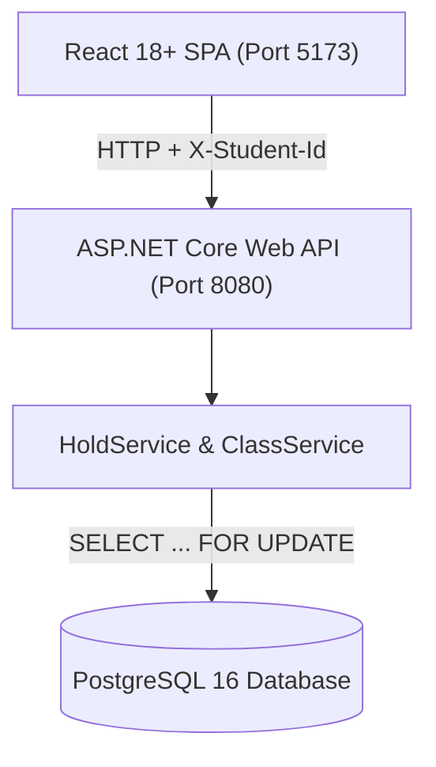

# School Admission System (বিদ্যালয় ভর্তি কার্যক্রম)

An online admission system designed for high-concurrency "first-come, first-served" (FCFS) enrollment with **no lottery**, built as a take-home hiring assignment for **Onnorokom Projukti Limited** (Assistant Software Engineer Recruitment).

---

## 🚀 Docker দিয়ে App চালানোর ধাপ (Quick Start with Docker)

The easiest way to run the entire stack (PostgreSQL, Backend API, and Frontend SPA) is using Docker Compose. **Host মেশিনে Node.js, .NET বা PostgreSQL ইনস্টল থাকার প্রয়োজন নেই।**

### ধাপ ১: প্রজেক্ট চালু করা
Repository-এর রুট ডিরেক্টরিতে কমান্ড প্রম্পট বা টার্মিনাল খুলে নিচের কমান্ডটি চালান:

```bash
docker compose up --build
```

এই কমান্ডটি:
1. PostgreSQL 16 ডাটাবেজ কন্টেইনার প্রস্তুত করবে এবং হেলথচেক সম্পন্ন করবে।
2. .NET 10 ব্যাকএন্ড বিল্ড করে `http://localhost:8080`-এ চালু করবে।
3. React 18+ Vite ফ্রন্টএন্ড বিল্ড করে `http://localhost:5173`-এ চালু করবে।

---

### 🌐 Frontend ও Backend কোন URL-এ খুলবে?

কন্টেইনারগুলো সফলভাবে চালু হলে আপনার ব্রাউজারে নিচের URL-এ প্রবেশ করুন:

| সার্ভিস | URL | বিবরণ |
| :--- | :--- | :--- |
| **Frontend UI (ব্রাউজারে খুলুন)** | **[http://localhost:5173](http://localhost:5173)** | শিক্ষার্থী ও অ্যাডমিনের মূল ইউজার ইন্টারফেস |
| **Backend Web API** | **[http://localhost:8080](http://localhost:8080)** | ASP.NET Core REST API সার্ভিস |
| **PostgreSQL Database** | **`localhost:5432`** | PostgreSQL ডাটাবেজ পোর্ট |

---

### কন্টেইনার বন্ধ করার নিয়ম
- ডাটাবেজের ডাটা সংরক্ষণ করে কন্টেইনার বন্ধ করতে:
  ```bash
  docker compose down
  ```
- ডাটাবেজের ডাটা এবং ভলিউম সম্পূর্ণ মুছে ফ্রেশ রিস্টার্ট দিতে:
  ```bash
  docker compose down -v
  ```

---

## 🧪 Test চালানোর নিয়ম (Running Automated Tests)

ব্যাকএন্ডে **xUnit** দিয়ে তৈরি মোট ৩১টি টেস্ট (Unit, Lifecycle এবং High-Burst Concurrency Race Tests) রয়েছে।

### টেস্ট রান করার কমান্ড:
Repository রুট থেকে নিচের কমান্ডটি চালান:

```bash
dotnet test backend/tests/SchoolAdmissionSystem.Tests/SchoolAdmissionSystem.Tests.csproj
```

### বিশেষ Concurrency টেস্টসমূহ:
1. **High-Burst Concurrency (`CreateHold_UnderHighBurstConcurrency_NeverExceedsTotalSeats`):**
   - একটি শ্রেণিতে আসন সংখ্যা ৫টি।
   - ৫০টি ভিন্ন ১৭ অঙ্কের শিক্ষার্থী আইডি থেকে একই মিলিসেকেন্ডে ৫০টি প্যারালাল রিকোয়েস্ট পাঠানো হয়।
   - **ফলাফল:** ঠিক ৫টি রিকোয়েস্ট `201 Created` পায়, বাকি ৪৫টি রিকোয়েস্ট `409 Conflict` পায়। আসন কখনই ৫-এর বেশি হয় না ($\text{held} + \text{confirmed} \le 5$ সংরক্ষিত থাকে)।
2. **Race for Final Seat (`CreateHold_SimultaneousRaceForFinalAvailableSeat_AllowsOnlyOneSuccess`):**
   - ১০টি আসনের মধ্যে ৯টি ইতোমধ্যে সংরক্ষিত, মাত্র ১টি আসন খালি আছে।
   - ২৫ জন শিক্ষার্থী একসাথে ওই শেষ ১টি আসনের জন্য রিকোয়েস্ট পাঠায়।
   - **ফলাফল:** ঠিক ১ জন আসন পায়, বাকি ২৪ জন `409 Conflict` পায়। কোনো অবস্থাতেই ওভারবুকিং ঘটে না।

### ফ্রন্টএন্ড বিল্ড টেস্ট:
```bash
cd frontend
npm run build
```
Vite ও TypeScript কম্পাইলার শূন্য ওয়ার্নিং ও শূন্য এররে প্রোডাকশন বিল্ড তৈরি করে।

---

## 📋 প্রজেক্টের বৈশিষ্ট্যসমূহ (Features)

### অভিভাবক ও শিক্ষার্থীদের জন্য:
- **১৭ অঙ্কের জন্ম নিবন্ধন নম্বর:** কোনো পাসওয়ার্ড বা লগইন সিস্টেম নেই; `X-Student-Id` হেডারে শিক্ষার্থীর ১৭ অঙ্কের জন্ম নিবন্ধন নম্বর দিলেই সিস্টেম শিক্ষার্থীকে শনাক্ত করে।
- **রিয়েল-টাইম আসন তালিকা:** প্রতি ৩.৫ সেকেন্ড পরপর কোনো পেজ রিলোড ছাড়াই নিজে থেকে হালনাগাদ হয়।
- **সাময়িক আসন সংরক্ষণ (Hold):** আসন খালি থাকলে সাথে সাথে শিক্ষার্থীর নামে সাময়িক সংরক্ষিত (HELD) হয়।
- **লাইভ কাউন্টডাউন টাইমার:** নির্ধারিত সময় (ডিফল্ট: ১০ মিনিট / ৬০০ সেকেন্ড) কাউন্টডাউন হতে থাকে। টাইমার `00:00`-এ পৌঁছালে পেজ রিলোড ছাড়াই স্ট্যাটাস নিজে থেকে `EXPIRED`-এ পরিণত হয়।
- **ভর্তি নিশ্চিতকরণ (Payment):** "ভর্তি ফি দিন" বাটনে চাপলে আসনটি স্থায়ীভাবে নিশ্চিত (CONFIRMED) হয়।
- **আবেদন বাতিল (Cancel):** শিক্ষার্থী চাইলে নিজের আবেদন বাতিল করে আসনটি অন্যদের জন্য সাথে সাথে উন্মুক্ত করে দিতে পারে।
- **আমার আবেদনসমূহ ("My Applications"):** শিক্ষার্থীর পূর্বের ও বর্তমান সকল আবেদনের স্ট্যাটাস ও মেয়াদের তালিকা।

### স্কুল অ্যাডমিনের জন্য:
- **নতুন শ্রেণি ও শিফট যোগ:** অ্যাডমিন প্যানেল ("+ নতুন ক্লাস তৈরি (Admin)") থেকে ক্লাসের নাম ও মোট আসন সংখ্যা দিয়ে নতুন শ্রেণি তৈরি করা যায়।
- **ডুপ্লিকেট ক্লাস প্রতিরোধ:** একই নামের ক্লাস পুনরায় তৈরি করা স্বয়ংক্রিয়ভাবে ব্লক করা হয়।

---

## 💻 Technology Stack

- **Backend:** C# (.NET 10 / ASP.NET Core Web API) — Listening on port `8080`
- **Database:** PostgreSQL 16 — Port `5432`
- **ORM & Concurrency:** Entity Framework Core with native PostgreSQL row-level locking (`SELECT ... FOR UPDATE`)
- **Frontend:** React 18.3+, TypeScript, Vite 5, Modern CSS — Port `5173`
- **Testing:** xUnit, EF Core InMemory Provider, Asynchronous Multi-Task Concurrency Testing
- **Orchestration:** Docker & Docker Compose (`docker-compose.yml`)

---

## 🏛️ সিস্টেম আর্কিটেকচার ও রিকোয়েস্ট ফ্লো



### আসন সংরক্ষণে Concurrency রক্ষার কৌশল:
1. `HoldService` একটি `ReadCommitted` ডাটাবেজ ট্রানজেকশন শুরু করে।
2. টার্গেট ক্লাসের রো-এর ওপর এক্সক্লুসিভ লক নেয়:
   ```sql
   SELECT * FROM classes WHERE "Id" = @classId FOR UPDATE;
   ```
3. এই লকের কারণে একই ক্লাসে সিট পেতে আসা অন্যান্য সকল কনকারেন্ট রিকোয়েস্ট কিউতে অপেক্ষা করে।
4. লক অবস্থায় বর্তমান সক্রিয় হোল্ড (`Status = 'HELD' AND ExpiresAt > CURRENT_TIMESTAMP`) এবং নিশ্চিত আসন (`Status = 'CONFIRMED'`) গণনা করা হয়।
5. আসন অবশিষ্ট থাকলে নতুন হোল্ড রেকর্ড ইনসার্ট করে ট্রানজেকশন `COMMIT` করা হয় (`201 Created`)।
6. আসন অবশিষ্ট না থাকলে ট্রানজেকশন `ROLLBACK` করে `409 Conflict` রিটার্ন করা হয়।
7. **জিরো-ল্যাটেন্সি আসন পুনরুদ্ধার:** মেয়াদ উত্তীর্ণ হোল্ডের ক্ষেত্রে ডাটাবেজে কোনো ব্যাকগ্রাউন্ড ক্রন জব বা সুইপারের প্রয়োজন হয় না; কুয়েরি করার সময়ই `ExpiresAt <= UtcNow` হলে সেই আসনটি সাথে সাথে খালি হিসেবে গণ্য হয়।

---

## 📁 Repository Structure

```text
School Admission System/
├── frontend/
│   ├── src/
│   │   ├── components/         # Header, ClassList, HoldDetailModal, MyHolds, ClassCreateModal
│   │   ├── context/            # StudentContext (persists 17-digit ID in localStorage)
│   │   ├── services/           # Typed API service with X-Student-Id injection
│   │   ├── types/              # DTO TypeScript interfaces
│   │   ├── App.tsx             # Main view router
│   │   ├── index.css           # Responsive styles & status badges
│   │   └── main.tsx
│   ├── public/
│   ├── .env.example
│   ├── Dockerfile              # Node 20 Alpine Vite development server
│   ├── package.json
│   ├── tsconfig.json
│   └── vite.config.ts
│
├── backend/
│   ├── src/
│   │   └── SchoolAdmissionSystem.Api/
│   │       ├── Common/         # StudentIdValidator (regex ^[0-9]{17}$)
│   │       ├── Controllers/    # ClassesController, HoldsController, MeController
│   │       ├── Data/           # ApplicationDbContext with PostgreSQL composite indexes
│   │       ├── DTOs/           # Request & Response public DTO contracts
│   │       ├── Exceptions/     # DomainExceptions (mapped to 400, 403, 404, 409)
│   │       ├── Middleware/     # ExceptionHandlingMiddleware
│   │       ├── Models/         # SchoolClass, SeatHold, HoldStatus
│   │       ├── Services/       # ClassService, HoldService (concurrency row lock)
│   │       ├── Program.cs      # Native .NET OpenApi, CORS, DI, Kestrel port 8080
│   │       ├── appsettings.json
│   │       └── SchoolAdmissionSystem.Api.csproj
│   │
│   ├── tests/
│   │   └── SchoolAdmissionSystem.Tests/
│   │       ├── ClassManagementTests.cs
│   │       ├── HoldLifecycleTests.cs
│   │       ├── ExpirationAndCancellationTests.cs
│   │       ├── StudentRuleTests.cs
│   │       ├── ConcurrencyTests.cs    # 50-task parallel burst & race for final seat
│   │       ├── TestDbContextFactory.cs
│   │       └── SchoolAdmissionSystem.Tests.csproj
│   │
│   ├── Dockerfile              # Multi-stage SDK build to ASP.NET Core runtime
│   └── SchoolAdmissionSystem.sln
│
├── docker-compose.yml          # Root-level multi-container orchestration
├── README.md                   # Complete system documentation
├── ASSUMPTIONS.md              # 14 domain assumptions + multi-instance concurrency proof
├── AI_USAGE.md                 # 10-point transparent AI usage disclosure
├── .env.example                # Configurable environment variable template
└── .gitignore                  # Clean exclusions (bin/, obj/, node_modules/, dist/, .env)
```

---

## 🌐 API Contract Reference

সকল সফল রেসপন্স camelCase JSON ফরম্যাট অনুসরণ করে:

| Method | Endpoint | Required Headers | Request Body | Status Codes | বিবরণ |
| :--- | :--- | :--- | :--- | :--- | :--- |
| `POST` | `/classes` | None | `{"name": "...", "totalSeats": 120}` | `201`, `400`, `409` | নতুন শ্রেণি ও শিফট তৈরি করে। |
| `GET` | `/classes` | None | None | `200` | আসন সংখ্যাসহ সকল ক্লাসের তালিকা দেয়। |
| `GET` | `/classes/{classId}` | None | None | `200`, `404` | নির্দিষ্ট ক্লাসের বিস্তারিত আসন তথ্য দেয়। |
| `POST` | `/classes/{classId}/holds` | `X-Student-Id` | None | `201`, `400`, `404`, `409` | শিক্ষার্থীর জন্য সাময়িক আসন হোল্ড করে। |
| `GET` | `/holds/{holdId}` | None | None | `200`, `404` | হোল্ডের বর্তমান অবস্থা ও মেয়াদ দেখায়। |
| `POST` | `/holds/{holdId}/confirm` | `X-Student-Id` | None | `200`, `400`, `403`, `404`, `409` | ভর্তি ফি জমা নিয়ে সিট নিশ্চিত করে। |
| `DELETE` | `/holds/{holdId}` | `X-Student-Id` | None | `204`, `400`, `403`, `404`, `409` | হোল্ড বাতিল করে সিট ছেড়ে দেয়। |
| `GET` | `/me/holds` | `X-Student-Id` | None | `200`, `400` | ওই শিক্ষার্থীর সকল পূর্বের ও বর্তমান আবেদন দেখায়। |

---

## ⚙️ Environment Variables Reference

প্রজেক্টের রুটে অবস্থিত `.env.example` ফাইলটির মাধ্যমে সকল কনফিগারেশন পরিবর্তনযোগ্য:

| Variable | Default Value | বিবরণ |
| :--- | :--- | :--- |
| `POSTGRES_DB` | `school_admission` | PostgreSQL ডাটাবেজের নাম |
| `POSTGRES_USER` | `postgres` | ডাটাবেজ ইউজারনেম |
| `POSTGRES_PASSWORD` | `postgres` | ডাটাবেজ পাসওয়ার্ড |
| `POSTGRES_PORT` | `5432` | হোস্ট মেশিনে ডাটাবেজ পোর্ট ম্যাপিং |
| `HOLD_DURATION_SECONDS` | `600` | আসন হোল্ড থাকার সময়সীমা (সেকেন্ডে, ডিফল্ট: ১০ মিনিট) |
| `ASPNETCORE_URLS` | `http://+:8080` | ব্যাকএন্ড লিসেনিং URL |
| `VITE_API_BASE_URL` | `http://localhost:8080` | ফ্রন্টএন্ড যে API URL-এ কল পাঠাবে |

---

## 🛠️ Docker ছাড়া লোকাল মেশিনে ম্যানুয়ালি চালানোর নিয়ম

### ব্যাকএন্ড রান করা:
```bash
cd backend/src/SchoolAdmissionSystem.Api
dotnet run
```
API স্বয়ংক্রিয়ভাবে ডাটাবেজ স্কিমা তৈরি করে `http://localhost:8080`-এ চালু হবে।

### ফ্রন্টএন্ড রান করা:
```bash
cd frontend
npm install
npm run dev
```
ফ্রন্টএন্ড `http://localhost:5173`-এ চালু হবে।

---

## 📌 গুরুত্বপূর্ণ বিজনেস রুলস (Business Rules)

1. **১৭ অঙ্কের আইডি:** `X-Student-Id` হেডারে অবশ্যই ১৭ অঙ্কের সংখ্যা থাকতে হবে (`^[0-9]{17}$`)। অন্যথায় `400 Bad Request` দেওয়া হবে।
2. **এক ক্লাসে একটি আবেদন:** একজন শিক্ষার্থী একটি ক্লাসে একই সময়ে একটার বেশি সক্রিয় হোল্ড বা নিশ্চিত ভর্তি রাখতে পারবে না (`409 Conflict`)।
3. **পুনরায় আবেদন:** হোল্ডের মেয়াদ শেষ হয়ে গেলে বা বাতিল করলে ওই ক্লাসে আসন খালি থাকলে শিক্ষার্থী আবার আবেদন করতে পারবে।
4. **Idempotent নিশ্চিতকরণ:** একই আবেদনে একাধিকবার "ভর্তি ফি দিন" চাপলেও একবারই সিট নিশ্চিত হবে এবং প্রতিবারই `200 OK` রিটার্ন করবে।
5. **মেয়াদোত্তীর্ণ আবেদন নিশ্চিত করা নিষেধ:** হোল্ডের মেয়াদ শেষ হয়ে গেলে আর কনফার্ম করা যাবে না (`409 Conflict`)।
6. **কনফার্ম হওয়া সিট বাতিল নিষেধ:** একবার ভর্তি নিশ্চিত হয়ে গেলে তা আর বাতিল করা যাবে না (`409 Conflict`)।
7. **মালিকানা যাচাই:** একজনের হোল্ড অন্য কোনো শিক্ষার্থী কনফার্ম বা ক্যান্সেল করতে পারবে না (`403 Forbidden`)।

---

## 📑 অন্যান্য ডকুমেন্টস

- **[ASSUMPTIONS.md](./ASSUMPTIONS.md):** এসাইনমেন্টে সরাসরি উল্লেখ না থাকা ১৪টি বিষয়ের যৌক্তিক সিদ্ধান্ত ও মাল্টি-ইনস্ট্যান্স কনকারেন্সি প্রুফ।
- **[AI_USAGE.md](./AI_USAGE.md):** ডেভেলপমেন্টে AI ব্যবহারের স্বচ্ছ বিবরণ ও ডেভেলপার ভেরিফিকেশন রিপোর্ট।
