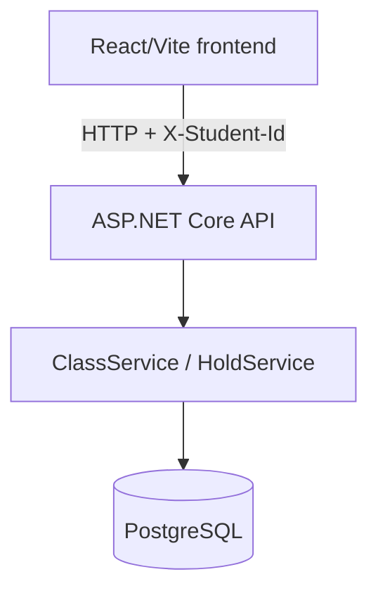

# School Admission System

An online first-come, first-served school admission system. A student is identified
by a 17-digit birth registration number supplied in the `X-Student-Id` header.
There is no login, user registration, lottery, or real payment gateway.

## What is implemented

- Create and list classes/shifts with a positive seat quota.
- Reserve a seat for a configurable period (default: 600 seconds).
- Confirm a held seat through a simulated payment action.
- Cancel an unconfirmed hold.
- View the current student's complete hold history.
- Calculate held, confirmed, and available seats dynamically.
- Prevent duplicate active/confirmed holds for the same student and class.
- Serialize hold creation per class in-process and, with PostgreSQL, acquire a
  database row lock before checking capacity.
- Refresh class inventory in the frontend every 3.5 seconds.
- Show a one-second countdown for the selected hold.

Class creation is labelled “Admin” in the UI, but the API currently has no
authentication or authorization for creating classes. Any caller who can reach the
API can call `POST /classes`.

## Technology

- **Backend:** ASP.NET Core Web API, C# and .NET 10 (`net10.0`)
- **Database:** PostgreSQL 16 in production/development
- **Data access:** Entity Framework Core 10 and Npgsql
- **Frontend:** React 18, TypeScript and Vite 5
- **Tests:** xUnit and EF Core InMemory provider
- **Containers:** Docker and Docker Compose

## Architecture



For PostgreSQL hold creation, `HoldService` starts a `ReadCommitted` transaction,
locks the target class row with `SELECT ... FOR UPDATE`, counts live held and
confirmed records, and inserts the hold only when capacity remains. The
application also uses an in-process semaphore per class. The tests use EF Core's
InMemory provider, so they exercise the service logic and in-process locking, not
PostgreSQL itself.

Hold status is evaluated dynamically:

```text
active hold = Status == HELD && ExpiresAt > current UTC time
```

Expired holds are reported as `EXPIRED` when read. No background expiration job
or database status sweep is used.

## Repository layout

```text
.
├── frontend/
│   ├── src/
│   │   ├── components/       # Class list, holds, header, modals, notifications
│   │   ├── context/          # Student ID and active hold localStorage state
│   │   ├── services/         # Fetch-based typed API client
│   │   └── types/            # TypeScript DTO types
│   ├── Dockerfile
│   └── package.json
├── backend/
│   ├── src/SchoolAdmissionSystem.Api/
│   │   ├── Controllers/
│   │   ├── Data/
│   │   ├── DTOs/
│   │   ├── Middleware/
│   │   ├── Models/
│   │   └── Services/
│   ├── tests/SchoolAdmissionSystem.Tests/
│   ├── Dockerfile
│   └── SchoolAdmissionSystem.sln
├── docker-compose.yml
├── .env.example
├── ASSUMPTIONS.md
└── AI_USAGE.md
```

## API

All successful JSON responses use camelCase property names.

| Method | Endpoint | Required header | Description |
|---|---|---|---|
| `POST` | `/classes` | None | Create a class or shift |
| `GET` | `/classes` | None | List classes with live seat counts |
| `GET` | `/classes/{classId}` | None | Get one class with live seat counts |
| `POST` | `/classes/{classId}/holds` | `X-Student-Id` | Create a temporary hold |
| `GET` | `/holds/{holdId}` | None | Get hold details and effective status |
| `POST` | `/holds/{holdId}/confirm` | `X-Student-Id` | Confirm a held seat |
| `DELETE` | `/holds/{holdId}` | `X-Student-Id` | Cancel a hold |
| `GET` | `/me/holds` | `X-Student-Id` | List the student's hold history |

`X-Student-Id` must contain exactly 17 numeric characters. The API returns
`400 Bad Request` for an invalid or missing value.

Typical status codes are:

- `201 Created` for class and hold creation
- `200 OK` for reads and confirmation
- `204 No Content` for cancellation
- `400 Bad Request` for validation errors
- `403 Forbidden` when a student attempts to modify another student's hold
- `404 Not Found` for an unknown class or hold
- `409 Conflict` for a full class, duplicate active hold, expired confirmation,
  cancelled confirmation, duplicate class name, or confirmed cancellation

### Example requests

Create a class:

```bash
curl -X POST http://localhost:8080/classes ^
  -H "Content-Type: application/json" ^
  -d "{\"name\":\"Class 6 - Morning Shift\",\"totalSeats\":120}"
```

List classes:

```bash
curl http://localhost:8080/classes
```

Create, confirm, and cancel a hold:

```bash
curl -X POST http://localhost:8080/classes/c_XXXXXXXX/holds ^
  -H "X-Student-Id: 20152691234567890"

curl -X POST http://localhost:8080/holds/h_XXXXXXXX/confirm ^
  -H "X-Student-Id: 20152691234567890"

curl -X DELETE http://localhost:8080/holds/h_XXXXXXXX ^
  -H "X-Student-Id: 20152691234567890"
```

The `c_XXXXXXXX` and `h_XXXXXXXX` values are examples; use IDs returned by the
API.

## Configuration

Copy the root [`.env.example`](./.env.example) when using Docker Compose. The
frontend also has a [frontend/.env.example](./frontend/.env.example) for
frontend-only development.

| Variable | Default | Used by |
|---|---:|---|
| `POSTGRES_DB` | `school_admission` | Compose PostgreSQL |
| `POSTGRES_USER` | `postgres` | Compose PostgreSQL |
| `POSTGRES_PASSWORD` | `postgres` | Compose PostgreSQL |
| `POSTGRES_PORT` | `5432` | Host port mapping |
| `HOLD_DURATION_SECONDS` | `600` | Backend hold duration |
| `ASPNETCORE_URLS` | `http://+:8080` | Backend listener |
| `VITE_API_BASE_URL` | `http://localhost:8080` | Frontend API base URL |

For a manually started backend, configure
`ConnectionStrings__DefaultConnection`, for example:

```text
Host=localhost;Port=5432;Database=school_admission;Username=postgres;Password=postgres
```

The checked-in `appsettings.json` contains a masked password placeholder and
should not be used as a real database credential.

## Run locally

### Prerequisites

- .NET 10 SDK
- Node.js 20 or later and npm
- PostgreSQL 16 or later

### Backend

Start PostgreSQL, set `ConnectionStrings__DefaultConnection`, then run:

```powershell
cd backend\src\SchoolAdmissionSystem.Api
dotnet run
```

The API listens on `http://localhost:8080` by default. On startup it calls
`EnsureCreatedAsync` for a relational database; it does not run EF migrations.

### Frontend

```powershell
cd frontend
npm install
npm run dev
```

The Vite development server listens on `http://localhost:5173`.

## Docker Compose

The intended command is:

```powershell
docker compose up --build
```

When the backend database connection is configured with the same password as
the PostgreSQL service, the services expose:

- Frontend: `http://localhost:5173`
- Backend: `http://localhost:8080`
- PostgreSQL: `localhost:5432`

Stop containers while preserving the named database volume:

```powershell
docker compose down
```

Stop containers and remove the database volume:

```powershell
docker compose down -v
```

**Current repository warning:** `docker-compose.yml` currently passes the
literal `******` value in the backend connection string instead of
`${POSTGRES_PASSWORD:-postgres}`. As committed, the backend may fail to
authenticate against the default PostgreSQL container. Correct that connection
string (or provide a database password matching the literal value) before
relying on the Compose startup command.

## Tests

Run the backend test project:

```powershell
dotnet test backend\tests\SchoolAdmissionSystem.Tests\SchoolAdmissionSystem.Tests.csproj
```

The repository currently contains **24 xUnit test cases** covering:

- class creation, validation, duplicate names, and inventory reads
- hold creation and the held/confirmed/cancelled lifecycle
- dynamic expiration and re-application
- 17-digit student ID validation and per-class duplicate prevention
- 50 concurrent requests competing for five seats
- 25 concurrent requests competing for the final seat

Build the frontend:

```powershell
cd frontend
npm run build
```

## Business rules

1. A student ID is exactly 17 digits and is sent in `X-Student-Id`.
2. A student cannot have more than one live hold or confirmed admission in the
   same class.
3. An expired or cancelled hold may be followed by a new application if a seat
   is available.
4. Confirming an already confirmed hold is idempotent and returns `200 OK`.
5. An expired or cancelled hold cannot be confirmed.
6. A confirmed admission cannot be cancelled.
7. Only the student who owns a hold can confirm or cancel it.
8. The capacity invariant is maintained for the hold-creation path:

   ```text
   live held seats + confirmed seats <= total seats
   ```

## Known limitations

- Payment is simulated; no payment provider is integrated.
- There is no authentication or role-based authorization.
- Inventory updates use HTTP polling rather than WebSockets or server-sent
  events.
- PostgreSQL row locking protects concurrent requests sharing the same database;
  high-availability or multi-datacenter deployment is outside this project.
- `EnsureCreatedAsync` is used instead of versioned database migrations.

Additional design decisions are documented in
[ASSUMPTIONS.md](./ASSUMPTIONS.md), and AI usage is documented in
[AI_USAGE.md](./AI_USAGE.md).
